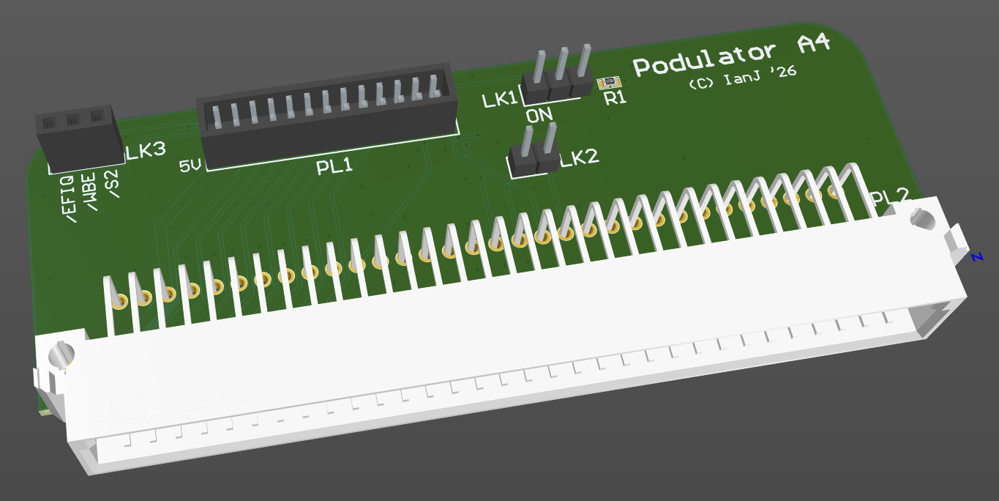

# An adapter for testing Acorn A4 modules with machines other than the A4

October 2026

A work in progress hardware design to allow A4 'Network slot' modules (Econet, Ethernet, etc) to be tested on machines with 16bit podule slots (nominally A3000, where this is readily accessible).

## Licence

No warranty is provided, and this work is used at your own risk.  

Licenced as CC BY-SA 4.0

Copyright 2026 Ian Jeffray
